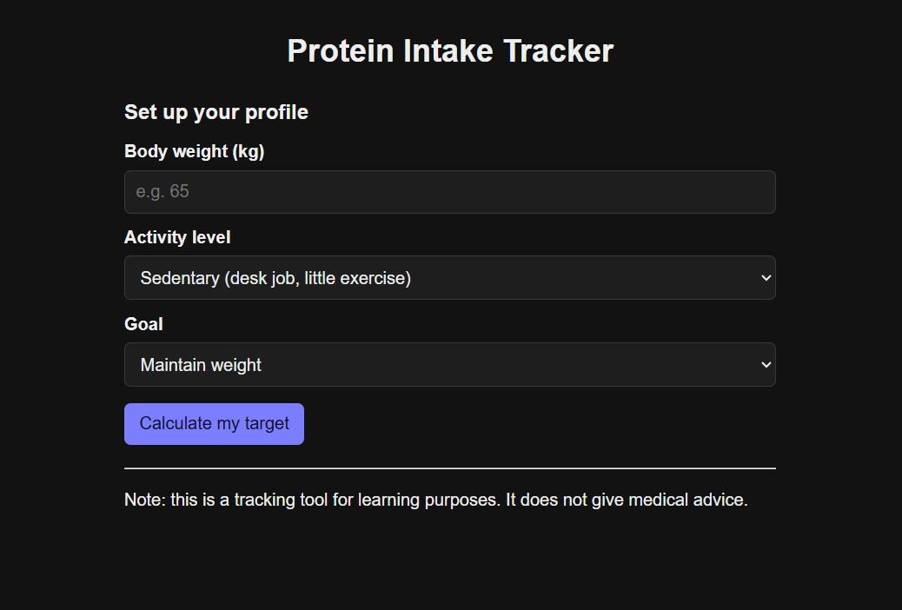
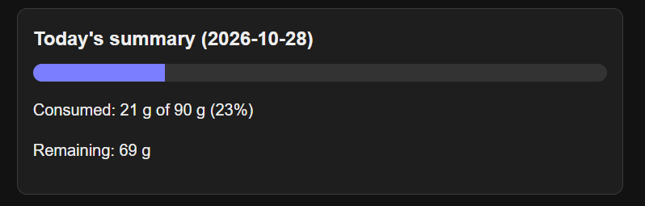
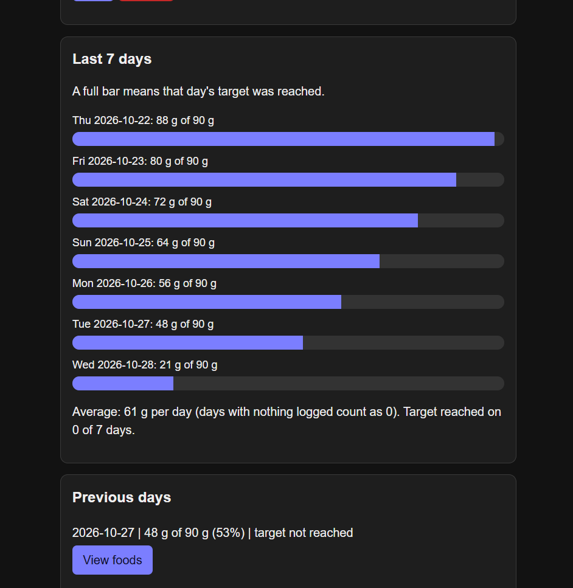

# Protein Intake Tracker

A simple website that helps you track how much protein you eat each day compared to a personal goal. You enter your weight, activity level and goal, and the app suggests a daily protein target. Then you log what you eat and see how close you are to the target, with a history of previous days.

I built this for Problem Statement 3 (Protein Intake Tracker). It uses only HTML, CSS and JavaScript, with no frameworks or libraries, and no backend.

**Live demo:** https://cse260001067-gif.github.io/protein-intake-tracker/

---

## Screenshots

**Profile setup**



**Tracker with today's summary and foods**



**History and weekly chart**



---

## Features

- **Profile setup:** enter body weight, activity level and goal. The app calculates a recommended daily protein target.
- **Manual target:** you can set your own target instead, and switch back to the recommended one anytime.
- **Add, edit and delete foods:** each entry has a name, quantity and protein in grams.
- **Built-in common foods:** a dropdown with 14 common foods (egg, paneer, dal, chicken, milk, curd, roti, rice, soya chunks, chana, peanuts, almonds, fish, whey protein) with protein per serving, so logging is quick. The protein is calculated automatically from the quantity. Custom foods can be typed in too.
- **Daily summary:** a progress bar showing protein eaten vs. the target, the percentage, and how much protein is remaining.
- **History:** a chart of the last 7 days (one bar per day), the average per day, how many days the target was reached, and a list of previous days where you can click "View foods" to see what was eaten.
- **Data is saved:** everything stays after refreshing the page (localStorage).
- **Input validation:** the app checks the inputs and shows a message if something is wrong (see below).
- **Mobile friendly and dark mode:** the layout works on phones, and the colours switch automatically if your device is in dark mode.

---

## Tech stack

- **HTML** for the structure
- **CSS** for the styling (CSS variables, responsive layout, dark mode)
- **JavaScript** (plain, no libraries) for the logic
- **localStorage** for saving data in the browser
- **GitHub Pages** for hosting

---

## How to run it

**Option 1: live link**

Open the live demo link at the top.

**Option 2: on my computer**

1. Download or clone this repository.
2. Keep `index.html`, `style.css` and `script.js` together in the same folder.
3. Open `index.html` in a browser. That's it, there's nothing to install.

---

## How the daily target is calculated

The recommended target is:

**body weight (kg) × grams of protein per kg**

The grams per kg depend on activity level, and the goal adds a little extra:

| Activity level | Grams per kg |
|---|---|
| Sedentary | 0.8 |
| Light | 1.0 |
| Moderate | 1.2 |
| Heavy | 1.6 |

| Goal | Extra grams per kg |
|---|---|
| Maintain weight | +0 |
| Lose fat | +0.2 |
| Build muscle | +0.4 |

**Example:** 65 kg, moderate activity, goal is to build muscle.
Grams per kg = 1.2 + 0.4 = 1.6, so the target is 65 × 1.6 = **104 g** of protein per day (rounded to a whole number).

The user can also type their own target (anything from 10 to 500 g).

I chose these numbers as a simple approach for a learning project. They are not medical advice, and real needs depend on the person.

---

## Where the food data comes from

The protein values in the common foods list are approximate values per serving, taken from **IFCT**.

Some servings are household measures (for example "1 katori"), so they are rough estimates and the real amount can vary. The list is stored in the `foods` array at the top of `script.js` and is easy to edit.

---

## How the data is stored

Everything is saved in the browser's **localStorage** as JSON text, under three keys:

- `profile`: weight, activity level, goal, recommended target and current target
- `entries`: every food entry
- `targets`: the target for each date

Each food entry looks like this:

```js
{ id: 1793180001738, date: "2026-10-28", name: "Egg", quantity: 2, protein: 12 }
```

Because every entry has a date, the history doesn't need separate storage. The app just groups the same entries by date. The `targets` object is there so that old days are compared with the target I had on that day, and not with today's target.

When the page opens, the saved text is loaded back with `JSON.parse`, which is why the data is still there after a refresh.

---

## Input validation

- Weight: between 20 and 300 kg
- Manual target: between 10 and 500 g
- Food name: can't be empty
- Quantity: more than 0 and at most 100
- Protein: between 0 and 500 g

If an input is wrong, the app shows a message and doesn't save it.

---

## Project structure

```
protein-intake-tracker/
├── index.html      # page structure
├── style.css       # styling and responsive layout
├── script.js       # all the logic (profile, foods, summary, history, localStorage)
├── screenshots/    # images used in this README
└── README.md
```

`script.js` is split into numbered parts with comments: data, helper functions, saving and loading, profile and target, food form, today's view, history, and app start.

---

## Limitations

- Data is saved only in the browser I use. It won't show up on another device, and clearing browser data deletes it.
- There are no user accounts, since there is no backend.
- Previous days are read-only. I can only edit or delete foods from today.
- The food list is small and the values are approximate.

---

## Ideas for later

- Edit and delete entries on past days
- Search a food nutrition API
- Track calories, carbs and fats
- Export history as CSV
- Proper streaks and reminders
- User accounts with a backend

---

## Help I used

I used an AI assistant (Claude) while building this project, to help with the code and to explain how certain things work. I also used it to help me with debugging and styling the website.

---

*Note: this is a tracking tool for learning purposes. It does not give medical advice.*
